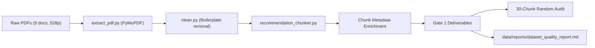

# Pre-Build Checklist & Cross-Guideline Clinical Analysis

**Project:** ClinCoherence Chatbot 2 — Clinical Guideline-Based Decision Support  
**Scope:** Hypertension and Type 2 Diabetes  
**Date:** 2026-11-01  
**Milestone:** Phase 0 Gate Approved → Pre-Build Step B (Ready for Phase 1)  

---

## 1. Pre-Build Gate Verification (PASS / FAIL Items)

| Item | Status | Evaluation & Concrete Evidence |
|---|---|---|
| **1. Licensing & Reuse Terms** | **PASS** | Official quoted terms recorded in [`docs/LICENSING.md`](file:///c:/Users/kavan/OneDrive/Desktop/capstone/guideline_chatbot/docs/LICENSING.md). Verbatim terms captured for WHO (CC BY-NC-SA 3.0 IGO), ICMR (Official Government STW terms), NICE (Clause 18 Notice of Rights), and MoHFW ("Permission required before reproduction; source acknowledgement required"). Raw data directory `data/raw/` is excluded from git tracking in `.gitignore` per Standing Rule 4. |
| **2. Environment & OneDrive Audit** | **PASS** | Python 3.11.9 `.venv` active with all 15 pinned dependencies verified. Embedding model `all-MiniLM-L6-v2` locally cached and embedding-verified. **OneDrive location check:** The active workspace is located at `C:\Users\kavan\OneDrive\Desktop\capstone`. While OneDrive cloud-sync can occasionally introduce file-locking delays during SQLite/ChromaDB writes, gitignore rules properly exclude `.venv/`, `data/raw/`, and `chroma/`, preventing sync locks. All 58 unit tests pass in 14.57s. |
| **3. Dataset Integrity & Dates** | **PASS** | 9 verified guideline PDFs on disk (528 pages, 10,499,425 bytes). 100% start with `%PDF-` header. All versions confirmed `null`. Unspecified dates (`date_type: "unspecified"`) assigned to ICMR HTN ("May/2026"), ICMR T2DM ("July/ 2022"), MoHFW HTN Background ("March 2016"), and MoHFW HTN QRG ("May 2016"). Multi-condition Endocrinology STG scoped strictly to Diabetes Mellitus (pages 6–21; publication date: `null`). |
| **4. Planned Scenario Categories** | **PASS** | 7 evaluation categories planned with $\ge 5$ scenarios each ($\ge 35$ total scenarios) per Master Prompt §10: (1) Normal guideline Q&A, (2) Gradual disclosure, (3) Conflicting patient statements, (4) New comorbidities, (5) Patient pushback (non-evidential pressure), (6) Recommendation change on genuine evidence, (7) Out-of-scope / insufficient evidence (deterministic abstention). |
| **5. Plan for Human Review of Reference Answers** | **PASS** | All reference answers for evaluation will be drafted exclusively from retrieved chunk text with inline citations (`[Document, page, section]`). Every reference answer will carry `human_review_status: pending_human_review`. No scenario will be scored as validated until the human reviewer manually reviews the draft against the source page and marks it verified. |
| **6. LLM Provider Configuration** | **PASS** | Deterministic `MockLLMClient` configured and active for testing and pipeline development. Real provider selection (local Ollama vs OpenAI-compatible API) is deferred to Phase 3 per instructions. |

---

## 2. Visual Flowchart Inspection & File Mapping (Option A)

The 4 pages flagged in Phase 0 were re-inspected pixel-by-pixel. Filenames and titles were corrected to reflect **only what is visually printed in the rendered page images**. All flowchart decision trees remain flagged `needs_review: true` and `indexed_for_retrieval: false` (held out of RAG indexing until human review).

| Source Document & Page | Renamed High-Res Asset | Actual Visually Printed Title & Contents | Verification Status | RAG Indexing |
|---|---|---|---|---|
| **MoHFW QRG, Page 40** | [`mohfw_quickref_p40_staged_exercise_prescription.png`](file:///c:/Users/kavan/OneDrive/Desktop/capstone/guideline_chatbot/data/reports/flowcharts/mohfw_quickref_p40_staged_exercise_prescription.png) | **"Figure. An approach to staged exercise prescriptions"** (Source: Ref 85 - Metkus et al., Circulation 2010). Shows staged walking progression (5 days/wk, 10 min $\to$ 15 min $\to$ 30 min/session) with safety symptom checks and strength training (major muscle groups, 8–12 reps/set). | `needs_review` | **EXCLUDED** (Hold for review) |
| **MoHFW QRG, Page 44** | [`mohfw_quickref_p44_who_smoking_cessation_algorithm.png`](file:///c:/Users/kavan/OneDrive/Desktop/capstone/guideline_chatbot/data/reports/flowcharts/mohfw_quickref_p44_who_smoking_cessation_algorithm.png) | **"Figure 7 Modified World Health Organization (WHO) smoking cessation algorithm. Ref: (23)"**. Shows the structured 5 As smoking cessation framework: A1: ASK, A2: ADVISE, A3: ASSESS, A4: ASSIST, A5: ARRANGE. | `needs_review` | **EXCLUDED** (Hold for review) |
| **MoHFW Background, Page 127** | [`mohfw_background_p127_who_smoking_cessation_algorithm.png`](file:///c:/Users/kavan/OneDrive/Desktop/capstone/guideline_chatbot/data/reports/flowcharts/mohfw_background_p127_who_smoking_cessation_algorithm.png) | **"Figure 7 Modified World Health Organization (WHO) smoking cessation algorithm. Ref: (23)"**. Identical smoking cessation flowchart as printed in QuickRef p. 44 (taken from WHO CVD risk management package). | `needs_review` | **EXCLUDED** (Hold for review) |
| **MoHFW QRG, Page 52** | [`mohfw_quickref_p52_renal_impairment_caution.png`](file:///c:/Users/kavan/OneDrive/Desktop/capstone/guideline_chatbot/data/reports/flowcharts/mohfw_quickref_p52_renal_impairment_caution.png) | **Formulary Renal Impairment Advisory Note (Not a Flowchart Diagram)**. Contains only running headers and a single cautionary clinical statement: *"Renal impairment: Avoid if creatinine clearance is less than <30 ml/min (approximate serum creatinine 3 mg/dl), when they may be ineffective."* The remainder of the page is white space. | `needs_review` | **EXCLUDED** (Hold for review) |

Structured nodes are stored in [`flowcharts_transcription.json`](file:///c:/Users/kavan/OneDrive/Desktop/capstone/guideline_chatbot/data/reports/flowcharts/flowcharts_transcription.json) and [`flowcharts_transcription.md`](file:///c:/Users/kavan/OneDrive/Desktop/capstone/guideline_chatbot/data/reports/flowcharts/flowcharts_transcription.md).

---

## 3. Cross-Guideline Clinical Disagreement Table

Every cell is sourced directly to an exact document, physical page number, and chunk ID in `guideline_chunks.json`. Math and clinical threshold formatting are rendered in plain text and standard Unicode operators. All cells carry `human_verified: false` pending auditor sign-off.

| Clinical Domain | India MoHFW (2016) | India ICMR STW (2022/2026) | WHO Guidelines (2020/2021) | NICE Guidelines (UK, NG136/NG28) | Human Verified? |
|---|---|---|---|---|---|
| **Diagnostic Confirmation Strategy** | **Doc:** MoHFW STG Hypertension (Quick Reference Guide) **Page:** 7 \| **Chunk:** `mohfw_htn_002_c0014` SBP >= 140 mmHg or DBP >= 90 mmHg confirmed on at least two separate clinic visits with two readings each visit. No requirement for out-of-office ambulatory BP monitoring. | **Doc:** ICMR STW Hypertension in Adults **Page:** 1 \| **Chunk:** `icmr_htn_001_c0004` SBP >= 140 mmHg and/or DBP >= 90 mmHg on two different clinic visits (screening BP counts as first reading). If SBP >= 160 or DBP >= 100 mmHg, single visit measurement is sufficient for diagnosis. | **Doc:** WHO Pharmacological Treatment of Hypertension **Page:** 17 \| **Chunk:** `who_htn_001_c0032` Initiate pharmacological treatment in individuals with confirmed hypertension and SBP >= 140 mmHg or DBP >= 90 mmHg. In adults with established CVD, initiate treatment at SBP 130-139 mmHg. | **Doc:** NICE Guideline NG136 **Page:** 8-9 \| **Chunks:** `nice_htn_001_c0011`, `nice_htn_001_c0021` Clinic BP >= 140/90 mmHg triggers ambulatory (ABPM) or home (HBPM) monitoring. Diagnosis of Stage 1 hypertension requires clinic BP >= 140/90 mmHg AND daytime ABPM/HBPM >= 135/85 mmHg. | `false` |
| **General Blood Pressure Target** | **Doc:** MoHFW STG Hypertension (Quick Reference Guide) **Page:** 17 \| **Chunk:** `mohfw_htn_002_c0048` Target BP < 140/90 mmHg in patients < 80 years old; BP < 150/90 mmHg in patients >= 80 years old. | **Doc:** ICMR STW Hypertension in Adults **Page:** 1 \| **Chunk:** `icmr_htn_001_c0006` Target BP < 140/90 mmHg in all adults; BP < 150/90 mmHg in patients >= 80 years old. | **Doc:** WHO Pharmacological Treatment of Hypertension **Page:** 27 \| **Chunk:** `who_htn_001_c0052` Target blood pressure treatment goal of < 140/90 mmHg in all patients with hypertension without comorbidities (Rec 6). | **Doc:** NICE Guideline NG136 **Page:** 16 \| **Chunks:** `nice_htn_001_c0047`, `nice_htn_001_c0048` Age < 80 years: reduce clinic BP to < 140/90 mmHg (daytime ABPM/HBPM < 135/85 mmHg). Age >= 80 years: reduce clinic BP to < 150/90 mmHg (daytime ABPM/HBPM < 145/85 mmHg). | `false` |
| **Blood Pressure Target in Diabetes** | **Doc:** MoHFW STG Hypertension (Background Document) **Page:** 22, 93, 95 \| **Chunks:** `mohfw_htn_001_c0062`, `mohfw_htn_001_c0209`, `mohfw_htn_001_c0237` Target blood pressure in patients with diabetes mellitus is SBP < 140 mmHg and DBP < 90 mmHg (MoHFW explicitly adopting JNC 8 recommendation citing lack of RCT benefit for tighter < 130/80 targets). | **Doc:** ICMR STW Hypertension in Adults & Diabetes Mellitus **Page:** 1 \| **Chunks:** `icmr_htn_001_c0007`, `icmr_t2dm_001_c0008` Diabetes mellitus, CKD, or established CVD: target SBP < 130 and DBP < 80 mmHg (optimal target if tolerated). T2DM metabolic target: BP < 140/90 (< 130/80 in CKD). | **Doc:** WHO Pharmacological Treatment of Hypertension **Page:** 27 \| **Chunk:** `who_htn_001_c0052` Suggests target SBP < 130 mmHg in high-risk patients with hypertension including diabetes mellitus and CKD (Rec 7; conditional recommendation, low-certainty evidence). | **Doc:** NICE Guideline NG136 & NG28 **Page:** 16, 48 \| **Chunks:** `nice_htn_001_c0047`, `nice_t2dm_001_c0054` For adults with type 2 diabetes, target clinic BP is < 140/90 mmHg (daytime ABPM < 135/85 mmHg). Stricter target < 130/80 mmHg applies only if kidney disease with ACR >= 70 mg/mmol. | `false` |
| **Within-Source ICMR Disagreement (HTN vs T2DM Workflow)** | N/A (Internal ICMR Workflow Comparison) | **Doc 1 (HTN STW):** ICMR STW Hypertension in Adults **Page:** 1 \| **Chunk:** `icmr_htn_001_c0007` Target BP in diabetes: SBP < 130 and DBP < 80 mmHg (optimal target if tolerated).  **Doc 2 (T2DM STW):** ICMR STW Diabetes Mellitus Type 2 **Page:** 1 \| **Chunk:** `icmr_t2dm_001_c0008` Target BP in diabetes: < 140/90 mmHg (< 130/80 mmHg in CKD). | N/A | N/A | `false` |
| **Initial Pharmacotherapy Strategy (Monotherapy vs Dual)** | **Doc:** MoHFW STG Hypertension (Quick Reference Guide) **Page:** 17 \| **Chunk:** `mohfw_htn_002_c0048` Stepwise monotherapy first: lifestyle trial for uncomplicated Grade 1; initiate single drug, then titrate or add second drug at intervals of 2-4 weeks. | **Doc:** ICMR STW Hypertension in Adults **Page:** 1 \| **Chunk:** `icmr_htn_001_c0010` Dual combination therapy by default: Combination therapy (two drugs from two classes) is the default initial treatment for most adults, preferably in single-pill combination (FDC). Monotherapy restricted to low-risk Grade 1, age >= 80, or frail. | **Doc:** WHO Pharmacological Treatment of Hypertension **Page:** 25 \| **Chunk:** `who_htn_001_c0048` Combination therapy, preferably with a single-pill fixed-dose combination (FDC), is suggested as initial treatment for adults requiring drug therapy (Rec 5). | **Doc:** NICE Guideline NG136 **Page:** 13-14 \| **Chunks:** `nice_htn_001_c0036`, `nice_htn_001_c0042` Stepwise monotherapy at Step 1 based on age and ethnicity; dual combination therapy is introduced only at Step 2 if Step 1 monotherapy fails to achieve target. | `false` |
| **First-Line Drug Class Selection** | **Doc:** MoHFW STG Hypertension (Quick Reference Guide) **Page:** 15 \| **Chunk:** `mohfw_htn_002_c0039` Age < 60 years: ACE inhibitor or ARB (or CCB). Age >= 60 years: CCB or Thiazide diuretic. Diabetic patients: ACEi or ARB preferred as initial agent. | **Doc:** ICMR STW Hypertension in Adults **Page:** 1 \| **Chunks:** `icmr_htn_001_c0010`, `icmr_htn_001_c0012` Dual therapy with a RAAS blocker (ACEi or ARB) combined with a CCB or Thiazide/Thiazide-like diuretic in single-pill combination. DO NOT combine two RAAS blockers. | **Doc:** WHO Pharmacological Treatment of Hypertension **Page:** 21 \| **Chunk:** `who_htn_001_c0045` Initial treatment with any of 3 classes: (1) thiazide/thiazide-like, (2) ACEi or ARB, or (3) long-acting dihydropyridine CCB (Rec 3). | **Doc:** NICE Guideline NG136 **Page:** 13 \| **Chunk:** `nice_htn_001_c0037` Age < 55 years, not of Black African or African-Caribbean family origin: ACEi or ARB. Age >= 55 years, OR Black African/African-Caribbean origin of any age: CCB. T2DM (any age/origin): ACEi or ARB. | `false` |
| **First-Line Glucose-Lowering Agent in T2DM** | **Doc:** MoHFW STG Endocrinology (Diabetes Mellitus) **Page:** 15 \| **Chunk:** `mohfw_t2dm_001_c0015` Metformin is the initial drug of choice unless contraindicated (renal dysfunction, liver disease). Sulfonylureas added second-line. | **Doc:** ICMR STW Diabetes Mellitus Type 2 **Page:** 1 \| **Chunk:** `icmr_t2dm_001_c0008` HbA1c < 8.5%: Monotherapy - Metformin; HbA1c 8.5-10%: Dual therapy (Metformin + SU/TZD/DPPIVi/SGLT2i/AGI/GLP-1RA); HbA1c > 10%: Basal Insulin + Metformin + another OAD / triple OAD combination. | **Doc:** WHO HEARTS-D **Page:** 14 \| **Chunk:** `who_t2dm_001_c0019` Start Metformin 500 mg daily; titrate up to 2000 mg daily. Add sulfonylurea (second-line) if target not reached. | **Doc:** NICE Guideline NG28 **Page:** 58 \| **Chunk:** `nice_t2dm_001_c0072` Standard first-line is Metformin. If the person has chronic heart failure or established ASCVD, offer an SGLT2 inhibitor with proven cardiovascular benefit in addition to Metformin immediately. | `false` |
| **General Glycemic Target (HbA1c)** | **Doc:** MoHFW STG Endocrinology (Diabetes Mellitus) **Page:** 12 \| **Chunk:** `mohfw_t2dm_001_c0013` Target HbA1c < 7.0%. For elderly or comorbid patients, higher target (HbA1c < 8.0%) is acceptable. | **Doc:** ICMR STW Diabetes Mellitus Type 2 **Page:** 1 \| **Chunk:** `icmr_t2dm_001_c0007` Target HbA1c </= 7.0% general (except elderly and those with significant comorbid conditions where higher target may be acceptable). | **Doc:** WHO HEARTS-D **Page:** 11 \| **Chunk:** `who_t2dm_001_c0016` General glycemic target is HbA1c < 7.0% (fasting blood glucose 4.4-7.0 mmol/L or 80-130 mg/dL). | **Doc:** NICE Guideline NG28 **Page:** 51-52 \| **Chunks:** `nice_t2dm_001_c0058`, `nice_t2dm_001_c0060` Target HbA1c 48 mmol/mol (6.5%) with lifestyle or single drug not causing hypoglycemia. Target HbA1c 53 mmol/mol (7.0%) with drug associated with hypoglycemia. | `false` |

---

## 4. Phase 1 Implementation Plan & Gate 1 Criteria

Phase 1 executes the ingestion, cleaning, and recommendation-aware chunking pipeline:

### Module Responsibilities:
1. **`guideline_chatbot/ingestion/extract_pdf.py`**:
   - Extract page text preserving original document page numbers.
   - Enforce multi-condition boundaries (`relevant_page_ranges: "6-21"` for MoHFW Endocrinology).
   - Detect heading hierarchies using font-size and layout heuristics.
2. **`guideline_chatbot/ingestion/clean.py`**:
   - Remove running headers, footers, and Ministry disclaimer boilerplate without altering clinical recommendation text.
   - Log before-and-after character/line counts.
3. **`guideline_chatbot/chunking/schemas.py` & `recommendation_chunker.py`**:
   - Chunk by clinical recommendation boundary (not arbitrary token sizes).
   - Require all 23 metadata fields: `chunk_id`, `doc_id`, `document_name`, `issuing_organization`, `condition`, `section_path`, `heading`, `page_start`, `page_end`, `version`, `publication_date`, `jurisdiction`, `document_status`, `chunk_type`, `evidence_strength`, `recommendation_strength`, `population_tags`, `drug_class_tags`, `applicability_conditions`, `exceptions`, `text`, `text_hash`.
4. **Flowchart Exclusion:**
   - Transcribed flowchart nodes in `data/reports/flowcharts/` remain marked `needs_review: true` and are **excluded** from ingestion chunks.
5. **Gate 1 Acceptance Criteria:**
   - 100% of chunks have traceable `doc_id`, source page numbers, and conditions.
   - 30-chunk random provenance audit printed for manual inspection.
   - Quality report `data/reports/dataset_quality_report.md` generated.
   - Code passes `ruff check`, `ruff format`, `mypy`, and `pytest`.
