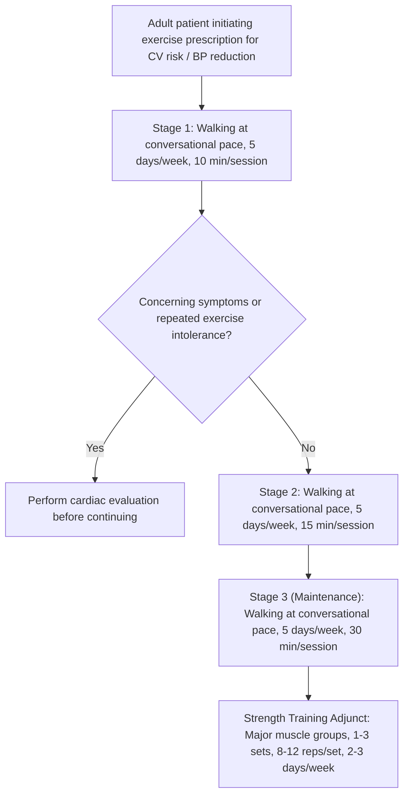
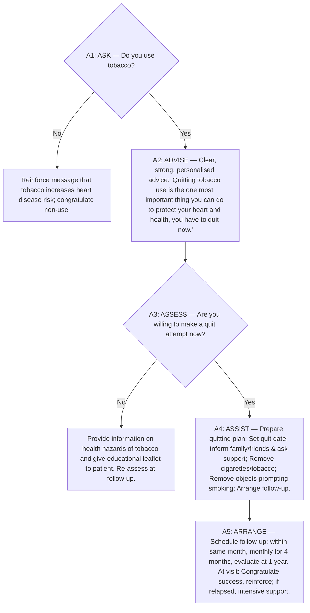

# MoHFW Guideline Flowchart Structured Transcriptions

> [!CAUTION]
> **VERIFICATION STATUS: `needs_review: true` | `indexed_for_retrieval: false`**  
> These structured decision nodes were transcribed directly from the rendered high-resolution page images of the MoHFW Standard Treatment Guidelines. Per Gate 0 approval directives, **these nodes MUST NOT be indexed for RAG retrieval** until each has been explicitly verified by the human reviewer against the page images.

---

## 1. Flowchart Overview & Image Mapping

| Flowchart ID | Source Document | Page | Verified Document Figure Title | Rendered High-Res Image | Verification Status | RAG Indexing Allowed? |
|---|---|---|---|---|---|---|
| `fc_mohfw_qr_p40` | MoHFW STG Quick Reference Guide (`6591.pdf`) | p. 40 | **Figure. An approach to staged exercise prescriptions** | [`mohfw_quickref_p40_staged_exercise_prescription.png`](file:///c:/Users/kavan/OneDrive/Desktop/capstone/guideline_chatbot/data/reports/flowcharts/mohfw_quickref_p40_staged_exercise_prescription.png) | `needs_review` | **NO** (Hold until human review) |
| `fc_mohfw_qr_p44` | MoHFW STG Quick Reference Guide (`6591.pdf`) | p. 44 | **Figure 7. Modified World Health Organization (WHO) smoking cessation algorithm** | [`mohfw_quickref_p44_who_smoking_cessation_algorithm.png`](file:///c:/Users/kavan/OneDrive/Desktop/capstone/guideline_chatbot/data/reports/flowcharts/mohfw_quickref_p44_who_smoking_cessation_algorithm.png) | `needs_review` | **NO** (Hold until human review) |
| `fc_mohfw_bg_p127` | MoHFW STG Background Document (`5191.pdf`) | p. 127 | **Figure 7. Modified World Health Organization (WHO) smoking cessation algorithm** (Identical to QRG p. 44) | [`mohfw_background_p127_who_smoking_cessation_algorithm.png`](file:///c:/Users/kavan/OneDrive/Desktop/capstone/guideline_chatbot/data/reports/flowcharts/mohfw_background_p127_who_smoking_cessation_algorithm.png) | `needs_review` | **NO** (Hold until human review) |
| `fc_mohfw_qr_p52` | MoHFW STG Quick Reference Guide (`6591.pdf`) | p. 52 | **Formulary Renal Impairment Advisory Note (Not a Flowchart Diagram)** | [`mohfw_quickref_p52_renal_impairment_caution.png`](file:///c:/Users/kavan/OneDrive/Desktop/capstone/guideline_chatbot/data/reports/flowcharts/mohfw_quickref_p52_renal_impairment_caution.png) | `needs_review` | **NO** (Hold until human review) |

---

## 2. Transcribed Flowchart 1: Staged Exercise Prescription
- **Source:** MoHFW STG Quick Reference Guide, Page 40 (Ref: 85 - Metkus et al., Circulation 2010; MoHFW STG Annexure 2).
- **Exact Title on Image:** *"Figure. An approach to staged exercise prescriptions: Any enjoyable, moderate-intensity activity such as those listed in Table 2 may be substituted for walking. Specific strength training exercises are also listed in Table 2. Rx indicates prescription. Source: Ref: (85)"*

### Node Dictionary
- **Node `P40_N1_entry`:** Entry for hypertensive patient initiating physical activity.
- **Node `P40_N2_stage1`:** Stage 1: Walking at conversational pace, 5 days/week, 10 minutes per session.
- **Node `P40_N3_check`:** Symptom check for chest pain, dyspnea, syncope, or exercise intolerance.
- **Node `P40_N4_eval`:** Action: Cardiac evaluation required before proceeding.
- **Node `P40_N5_stage2`:** Stage 2: Walking at conversational pace, 5 days/week, 15 minutes per session.
- **Node `P40_N6_stage3`:** Stage 3: Walking at conversational pace, 5 days/week, 30 minutes per session (target 150 mins/week).
- **Node `P40_N7_strength`:** Strength training adjunct: Major muscle groups (bicep curls, military press, shrugs, squats, leg curls), 1–3 sets, 8–12 reps/set, 2–3 days/week.

---

## 3. Transcribed Flowchart 2: Modified WHO Smoking Cessation Algorithm (5 As)
- **Source:** MoHFW STG Quick Reference Guide, Page 44 & Background Document, Page 127.
- **Exact Title on Image:** *"Figure 7 Modified World Health Organization (WHO) smoking cessation algorithm. Ref: (23)"* (Taken with permission from WHO CVD risk management package).

### Node Dictionary
- **Step `A1: ASK`:** Inquire about tobacco use at every patient contact.
- **Step `A2: ADVISE`:** Provide strong, unambiguous, personalized medical advice on quitting.
- **Step `A3: ASSESS`:** Evaluate readiness to make a quit attempt immediately.
- **Step `A4: ASSIST`:** Deliver structured cessation counseling (quit date, social support, stimulus control).
- **Step `A5: ARRANGE`:** Establish concrete longitudinal follow-up schedule aligned with BP monitoring visits.

---

## 4. Visual Inspection of QuickRef Page 52: Renal Impairment Advisory
- **Source:** MoHFW STG Quick Reference Guide, Page 52.
- **Image Inspection Finding:** **This page does NOT contain a flowchart or diagram.** The page contains standard running headers/footers with a single isolated clinical advisory sentence:
  > *"Renal impairment: Avoid if creatinine clearance is less than <30 ml/min (approximate serum creatinine 3 mg/dl), when they may be ineffective."*
- **Reason for Prior Flag:** Generated as a sparse page in PDF rendering with 234 null background vector tiles, leaving the middle 80% as blank white space.
- **Transcribed Element:** Documented strictly as a cautionary text block regarding thiazide inefficacy in severe renal impairment (CrCl $< 30\text{ ml/min}$).
