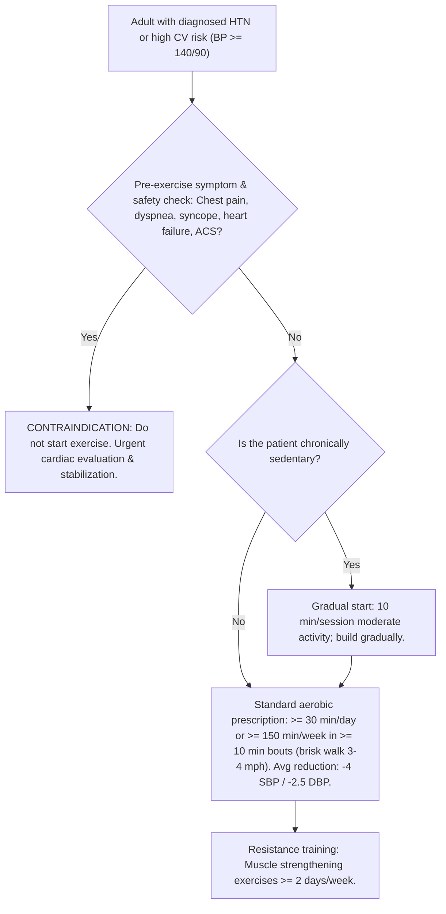
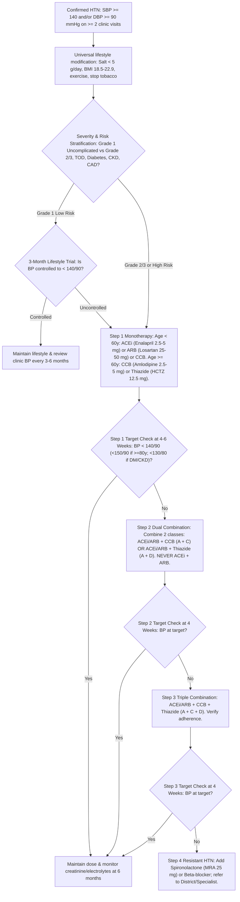
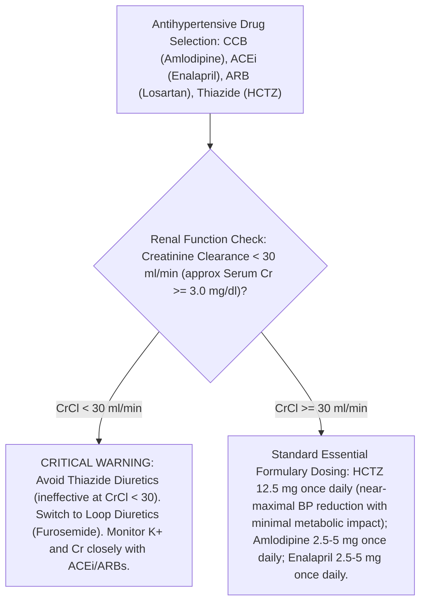

# MoHFW Guideline Flowchart Structured Transcriptions

> [!CAUTION]
> **VERIFICATION STATUS: `needs_review: true` | `indexed_for_retrieval: false`**  
> These structured decision nodes were transcribed from the embedded flowchart drawings of the MoHFW Standard Treatment Guidelines. Per Gate 0 approval directives, **these nodes MUST NOT be indexed for RAG retrieval** until each has been explicitly verified by the human reviewer against the rendered high-resolution page images.

---

## 1. Flowchart Overview & Image Mapping

| Flowchart ID | Source Document | Page | Rendered High-Res Image | Verification Status | RAG Indexing Allowed? |
|---|---|---|---|---|---|
| `fc_mohfw_qr_p40` | MoHFW STG Quick Reference Guide (`6591.pdf`) | p. 40 | [`mohfw_quickref_p40_adult_htn_algorithm.png`](file:///c:/Users/kavan/OneDrive/Desktop/capstone/guideline_chatbot/data/reports/flowcharts/mohfw_quickref_p40_adult_htn_algorithm.png) | `needs_review` | **NO** (Hold until human review) |
| `fc_mohfw_qr_p44` | MoHFW STG Quick Reference Guide (`6591.pdf`) | p. 44 | [`mohfw_quickref_p44_diabetic_htn_algorithm.png`](file:///c:/Users/kavan/OneDrive/Desktop/capstone/guideline_chatbot/data/reports/flowcharts/mohfw_quickref_p44_diabetic_htn_algorithm.png) | `needs_review` | **NO** (Hold until human review) |
| `fc_mohfw_bg_p127` | MoHFW STG Background Document (`5191.pdf`) | p. 127 | [`mohfw_background_p127_screening_diagnosis_flowchart.png`](file:///c:/Users/kavan/OneDrive/Desktop/capstone/guideline_chatbot/data/reports/flowcharts/mohfw_background_p127_screening_diagnosis_flowchart.png) | `needs_review` | **NO** (Hold until human review) |
| `fc_mohfw_qr_p52` | MoHFW STG Quick Reference Guide (`6591.pdf`) | p. 52 | [`mohfw_quickref_p52_pregnancy_htn_algorithm.png`](file:///c:/Users/kavan/OneDrive/Desktop/capstone/guideline_chatbot/data/reports/flowcharts/mohfw_quickref_p52_pregnancy_htn_algorithm.png) | `needs_review` | **NO** (Hold until human review) |

---

## 2. Transcribed Flowchart 1: Physical Activity & Exercise Prescription
- **Source:** MoHFW STG Quick Reference Guide, Page 40 (Ref: 85 - Metkus et al., Circulation 2010; MoHFW STG Annexure 2).
- **Target Condition:** Adult Hypertension (Lifestyle & Non-Pharmacological Management).

### Node Dictionary
- **Node `N1` (Entry):** Adult presenting with diagnosed hypertension or high CVD risk.
- **Node `N2` (Decision/Check):** Clinical safety screen for chest discomfort, jaw pain, palpitations, syncope, dyspnea, decompensated heart failure, or acute coronary syndrome.
- **Node `N3` (Action/Contraindication):** Exercise contraindicated. Urgent referral/workup required before any exercise program.
- **Node `N4` (Decision/Check):** Activity history assessment: chronically sedentary vs active.
- **Node `N5` (Action):** Start with 10 minutes moderate activity per session; gradually titrate upward to prevent acute cardiac events and musculoskeletal trauma.
- **Node `N6` (Action/Prescription):** Moderate-intensity physical activity of 30 mins/day or >= 150 mins/week, 4–7 days/week (brisk walking, cycling).
- **Node `N7` (Action/Prescription):** Resistance muscle-strengthening exercises on at least 2 days per week.

---

## 3. Transcribed Flowchart 2: Adult Hypertension Diagnosis, Stratification & Treatment Pathway
- **Source:** MoHFW STG Quick Reference Guide, Page 44 & Background Document, Page 127 (Ref: 23 - European Guidelines on CVD Prevention / MoHFW Section 7 Management Pathway).
- **Target Condition:** Primary Hypertension in Adults.

---

## 4. Transcribed Flowchart 3: Essential Formulary & Renal Safeguards
- **Source:** MoHFW STG Quick Reference Guide, Page 52 (Formulary Summary & Renal Footnote).
- **Target Condition:** Drug safety and dosing boundaries in renal impairment.

### Footnote Citation from Page 52:
> *"Renal impairment: Avoid if creatinine clearance is less than <30 ml/min (approximate serum creatinine 3 mg/dl), when they may be ineffective."*

